# Modelo dimensional del Observatorio del Cuidado

Versión 1.0.0 · 20 oct 2026 · **Sin revisión de otra persona** (regla de doble revisión pendiente).
Esquema ejecutable: `DW/sql/01_schema_dw.sql`. Vistas de los data marts: `DW/sql/02_vistas_marts.sql`.

## 1. Qué es y qué no es

Es un almacén de **indicadores publicados**: estimaciones de encuesta con intervalo de confianza, conteos y razones por alcaldía, y costos de relevo. Cada hecho es una cifra ya agregada por un notebook, con su fuente, su periodo, su nivel geográfico y la fila del archivo de origen.

No es un cubo libre. Solo se puede segmentar por lo que los notebooks ya tabularon (sexo, edad, ingreso, intensidad de horas, a quién se cuida). Un cruce que nadie calculó no existe en el almacén, y no se puede obtener sumando filas: las estimaciones no son aditivas. La razón es técnica: la varianza de la ENASIC se calcula con linealización de Taylor, estratos y UPM, y no se reproduce con un `SUM` en SQL. Por eso el ETL integra resultados y no recalcula nada de encuesta.

## 2. Hechos y granos

| Hecho | Grano (una fila = …) | Medidas | Filas |
|---|---|---|---|
| `fact_estimacion_encuesta` | una estimación: indicador × dominio (segmento) × geografía × periodo × fuente | `estimacion`, `se`, `cv`, `li90`, `ls90`, `n_muestra_dominio`, `n_muestra_si`, `total_expandido`, `dif_pp`, `dif_li90`, `dif_ls90`, `dif_significativa` | 965 |
| `fact_indicador_territorial` | una medida de una alcaldía o entidad en un periodo y fuente | `valor` (o `valor_texto`), `cv`, `li90`, `ls90`, `n_muestra` | 878 |
| `fact_asequibilidad` | % de hogares que pueden pagar un paquete bajo un umbral: geografía × ingreso de referencia × salario × paquete × umbral | `pct_hogares_asequible`, `cv`, `li90`, `ls90`, `total_expandido` | 150 |
| `fact_costo_paquete` | costo mensual de un paquete bajo un salario de referencia | `costo_mensual_2026`, `costo_mensual_base_2022`, `costo_pct_ingreso_mediano` | 50 |

Tres hechos distintos porque los granos son distintos y mezclarlos obligaría a repetir filas (por ejemplo, el costo de un paquete se repetiría tres veces, una por umbral, y alguien lo sumaría).

**Aditividad.** Ninguna medida de estos hechos se suma entre filas, con dos excepciones declaradas: `total_expandido` dentro del mismo dominio y mismo indicador, y las medidas territoriales con `dim_medida.aditiva = 1` (conteos de establecimientos, personas, AGEB). Los porcentajes, índices, razones y cualquier intervalo nunca.

## 3. Dimensiones y matriz de bus

| Dimensión | `fact_estimacion_encuesta` | `fact_indicador_territorial` | `fact_asequibilidad` | `fact_costo_paquete` |
|---|:-:|:-:|:-:|:-:|
| `dim_tiempo` (conformada) | ✔ | ✔ | ✔ | ✔ |
| `dim_fuente` (conformada) | ✔ | ✔ | ✔ | ✔ |
| `dim_geografia` (conformada; Nacional > Entidad > Alcaldía) | ✔ | ✔ | ✔ | ✔ |
| `dim_precision` (conformada) | ✔ | ✔ | ✔ | |
| `dim_indicador` | ✔ | | | |
| `dim_segmento` | ✔ | | | |
| `dim_medida` | | ✔ | | |
| `dim_paquete`, `dim_salario_ref`, `dim_ingreso_ref` | | | ✔ | ✔ |

Cada dimensión tiene un miembro `sk = 0` «desconocido / no aplica» donde corresponde. `dim_tiempo` incluye `desconocido` porque tres archivos del proyecto (P01, P02, P03) no declaran su año; entran con ese periodo y no con un año supuesto.

Todas las dimensiones son tipo 1 (se sobrescriben). No hay dimensión que cambie con el tiempo: los datos son publicaciones puntuales y el almacén se reconstruye completo en cada corrida. Si una decisión cambia, la historia vive en la bitácora, no aquí.

## 4. Diagrama

```mermaid
erDiagram
  dim_tiempo      ||--o{ fact_estimacion_encuesta : periodo
  dim_fuente      ||--o{ fact_estimacion_encuesta : fuente
  dim_geografia   ||--o{ fact_estimacion_encuesta : geografia
  dim_precision   ||--o{ fact_estimacion_encuesta : precision
  dim_indicador   ||--o{ fact_estimacion_encuesta : indicador
  dim_segmento    ||--o{ fact_estimacion_encuesta : dominio

  dim_tiempo      ||--o{ fact_indicador_territorial : periodo
  dim_fuente      ||--o{ fact_indicador_territorial : fuente
  dim_geografia   ||--o{ fact_indicador_territorial : geografia
  dim_precision   ||--o{ fact_indicador_territorial : precision
  dim_medida      ||--o{ fact_indicador_territorial : medida

  dim_tiempo      ||--o{ fact_asequibilidad : periodo
  dim_fuente      ||--o{ fact_asequibilidad : fuente
  dim_geografia   ||--o{ fact_asequibilidad : geografia
  dim_precision   ||--o{ fact_asequibilidad : precision
  dim_paquete     ||--o{ fact_asequibilidad : paquete
  dim_salario_ref ||--o{ fact_asequibilidad : salario
  dim_ingreso_ref ||--o{ fact_asequibilidad : ingreso

  dim_tiempo      ||--o{ fact_costo_paquete : periodo
  dim_fuente      ||--o{ fact_costo_paquete : fuente
  dim_geografia   ||--o{ fact_costo_paquete : geografia
  dim_paquete     ||--o{ fact_costo_paquete : paquete
  dim_salario_ref ||--o{ fact_costo_paquete : salario
  dim_ingreso_ref ||--o{ fact_costo_paquete : ingreso

  dim_geografia   ||--o{ dim_geografia : padre
```

## 5. Data marts

Un mart es un proceso de decisión con sus dimensiones, no una copia de todo. Son vistas planas; el ETL las exporta a `DW/marts/*.csv` (UTF-8 con BOM, abren directo en Excel y Power BI).

| Mart | Decisión que apoya | Hecho(s) | Nivel geográfico |
|---|---|---|---|
| `v_mart_necesidad_cuidado` | ¿Quién carga, quién queda sin servicio y por qué razón? | `fact_estimacion_encuesta` | solo Nacional |
| `v_mart_territorio` (largo) y `v_mart_perfil_alcaldia` (ancho, 16 filas) | ¿Dónde hay brecha entre oferta y población 60+? | `fact_indicador_territorial` | Alcaldía; Entidad para ENIGH |
| `v_mart_asequibilidad` | ¿Qué hogares pueden pagar un relevo y con qué supuestos? | `fact_asequibilidad` + `fact_costo_paquete` | Nacional y CDMX (entidad) |

Vistas de gobierno (las reglas del proyecto como consultas): `v_cobertura_temporal` (¿hay ≥ 2 periodos? → `permite_tendencia`), `v_cobertura_geografica` (alcaldías sin dato), `v_violaciones_alcance` (debe estar vacía), `v_calidad_precision`, `v_diccionario_medidas`.

## 6. Decisiones de diseño y alternativas descartadas

1. **SQLite, no un servidor.** El equipo no tiene infraestructura ni la decisión de arquitectura (`Backend/` está vacío a propósito). SQLite es un archivo, abre en DB Browser y se versiona el procedimiento, no el archivo. Costo: Power BI solo lo lee con un controlador ODBC de SQLite; para evitarlo están los CSV de los marts.
2. **Microdatos fuera del almacén.** Cargar la ENASIC por persona invitaría a hacer `SUM(factor)` y `AVG` ingenuos, con factores de expansión distintos según la tabla (vivienda, hogar, población cuidadora, persona elegida, hogares unipersonales) y sin varianza de diseño. Además la regla del proyecto es no subir datos personales ni seudonimizados. Los microdatos siguen en `Analysis/datos/enasic/` (ignorados por git).
3. **Indicadores como hecho único con `dim_indicador`.** Es el patrón de un almacén de indicadores. Su costo es que la clave natural del indicador son siete columnas de texto: los notebooks no emiten un `indicador_id` canónico. Deuda de diseño: si los notebooks lo emitieran, `dim_indicador` sería más simple y los cruces entre scripts (03, 07, 12) serían directos.
4. **`estimacion` y `unidad`, no `pct`.** En `12b_segmentacion_series.csv` la columna `pct` trae porcentajes, horas totales (2.36e8), horas promedio y diferencias en pp. Cargarla como porcentaje habría sido un error silencioso. Cada indicador declara su unidad y su tipo de estimación.
5. **Desconocido no es cero.** Las alcaldías sin dato no tienen fila; `v_cobertura_geografica` las lista. `oferta_por_alcaldia.csv` trae 0 plazas en tres alcaldías donde la ficha de la fuente dice que no hay dato: no se cargaron.
6. **Medidas derivadas se marcan.** `calidad_valor` distingue `observado`, `derivado`, `derivado (mezcla de fuentes)`, `derivado (modelo)` y `derivado (ETL)`. Un índice que mezcla DENUE 05/2026 con un archivo de año desconocido no se presenta como observado.
7. **Alcance como restricción verificable.** `dim_fuente.nivel_geo_max_orden` y `v_violaciones_alcance` hacen que una cifra de la ENASIC en nivel alcaldía sea imposible de pasar el ETL (probado: el ETL falla).

## 7. Lo que NO se modeló, y por qué

- **Desempeño operativo y financiero de la plataforma.** El incidente crítico de la UCA lo menciona, pero no existe ningún dato operativo: no hay piloto ni sede definida. Diseñar un `fact_servicio` ahora sería diseñar la solución antes del hallazgo. Se modela cuando exista la sede y los datos que recabe (que, por regla, quedan en la institución receptora; el Observatorio recibe solo agregados).
- **Escenarios de sostenibilidad (scripts 19 y 20).** Son salidas de modelo con supuestos de diseño, no observaciones. Mezclarlas con estimaciones de encuesta en el mismo almacén confunde el origen de la cifra. Si se incorporan, irían en un hecho aparte con `es_simulado = 1` declarado.
- **Puntos del DENUE y AGEB individuales.** Dan resolución, pero el Observatorio hoy consume el agregado por alcaldía y la tipología ya viene calculada.
- **Variantes QL A/B del notebook 02.** No se cargaron porque este ETL no verificó qué distingue A de B.
