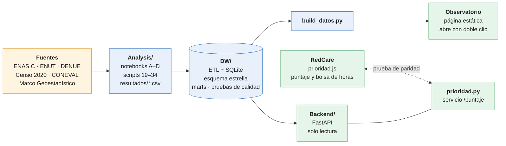

<div align="center">


<h1>Observatorio de Datos para la Economía del Cuidado</h1>
<h3>Quién cuida, quién no puede cubrir ese cuidado y dónde — Ciudad de México · PP 26-2</h3>

<p>
  
  
  
  
</p>
<p>
  
  
  
  
</p>
<p>
  
  
  
</p>

<p>
  <a href="https://zidnz.github.io/pp26-2/Frontend/observatorio/"><strong>Ver el Observatorio</strong></a> ·
  <a href="https://zidnz.github.io/pp26-2/Frontend/"><strong>Probar RedCare</strong></a>
</p>

<blockquote>
<strong>Pregunta central:</strong> ¿a qué cuidadoras familiares de alta intensidad conviene ofrecer primero un <em>relevo por horas</em> (3 a 12 h/semana), y en qué zonas de la CDMX hace falta la oferta?
</blockquote>
</div>

---

> **Proyecto académico.** Lo hizo el equipo del 7.º semestre de la Licenciatura en Ciencia de Datos para el Negocio (UNRC), semestre 2026-2.
> El Observatorio usa **datos reales y agregados** (ENASIC 2022, ENUT 2024, DENUE, Censo 2020, CONEVAL). La app RedCare usa **datos simulados**, declarados como tales.
> No se sube ningún dato personal, ni siquiera seudonimizado.

## Tabla de contenidos

- [Qué es](#qué-es)
- [Componentes](#componentes)
- [Qué responde el Observatorio](#qué-responde-el-observatorio)
- [Arquitectura](#arquitectura)
- [Estructura del repositorio](#estructura-del-repositorio)
- [Cómo correrlo](#cómo-correrlo)
- [Reglas del proyecto](#reglas-del-proyecto)
- [Documentación](#documentación)
- [Equipo](#equipo)

---

## Qué es

Un **observatorio de datos** sobre la economía del cuidado en la Ciudad de México, con tres piezas que comparten los mismos datos y las mismas reglas:

1. **Análisis reproducible** (notebooks y scripts) que estima la necesidad de cuidado, las barreras de uso, el costo de un programa de relevo y la brecha entre oferta y población por zona.
2. **Un almacén de datos** (esquema estrella + ETL) que integra los resultados y hace cumplir las reglas de calidad en código.
3. **Dos interfaces:** el **Observatorio** (tablero para quien decide) y **RedCare** (prototipo móvil del programa de relevo).

El programa que se evalúa es la **opción C: relevo por horas** para cuidadoras familiares de alta intensidad. Se eligió el 5 de octubre de 2026 y el motivo está en la bitácora.

## Componentes

| Componente | Carpeta | Qué hace |
|---|---|---|
| **Observatorio** | [`Frontend/observatorio/`](Frontend/observatorio) | Tablero HTML de una sola página, con nueve pestañas y mapas por alcaldía, estado y AGEB. Abre con doble clic, sin servidor. |
| **RedCare** | [`Frontend/`](Frontend) | App móvil en HTML/CSS/JS puro: entrevista, puntaje, nivel de prioridad, bolsa de horas y asignación de relevo. Una vista por rol (cuidadora, relevo, programa). |
| **Análisis** | [`Analysis/`](Analysis) | Cuatro notebooks (A–D) y los scripts 19 a 34: oferta, ENASIC, asequibilidad, tipología de AGEB, focalización y cobertura. |
| **Data warehouse** | [`DW/`](DW) | SQLite con 13 dimensiones, 5 hechos, 4 data marts, ETL con 30 pruebas de calidad y consultas OLAP. |
| **Backend** | [`Backend/`](Backend) | API FastAPI de solo lectura sobre el DW (`/dw/*`) y servicio de puntaje sin estado (`/puntaje/*`). No guarda datos. |
| **Documentos** | [`Documentos/`](Documentos) | Bitácora de decisiones, preregistro del modelo de focalización, documento técnico e informes. |

## Qué responde el Observatorio

| Pestaña | Pregunta |
|---|---|
| **Inicio** | ¿Qué encontramos, en tres marcos con escenas 3D? |
| **Necesidad** | ¿Quién carga el cuidado y qué afectaciones suben con más horas? |
| **Barreras** | ¿Por qué quien necesita cuidado no usa servicios? |
| **Segmentación** | ¿Qué perfiles de cuidadoras hay? |
| **Relevo** | ¿Cuánto cuesta la hora y es asequible para las familias? |
| **Focalización** | ¿La regla de 40 h o más sirve para elegir a quién atender? ¿Un modelo lo hace mejor? |
| **¿Dónde?** | ¿Qué alcaldías, entidades y AGEB tienen mayor brecha entre población y oferta? |
| **Indicadores** | ¿Qué tan precisa es cada cifra y con qué fuente? |
| **Método** | ¿Cómo se hizo, y qué sigue sin revisar? |

Cada cifra del tablero lleva su fuente, su precisión (intervalo de confianza) y su estado de revisión.

## Arquitectura



## Estructura del repositorio

```
pp26-2/
├── Analysis/            notebooks A–D, scripts 19–34, resultados/, figuras/, matrices/
│   └── enut2024_participacion_laboral/   subproyecto ENUT 2024 (Python y R/Quarto)
├── DW/                  esquema estrella, ETL, marts y consultas OLAP
├── Backend/             API FastAPI (+ pruebas, incluida la de paridad con el JS)
├── Frontend/            RedCare (app móvil)
│   └── observatorio/    el Observatorio (tablero) y su generador de datos
├── Data/                insumos de referencia (los microdatos grandes no se suben)
├── Documentos/          bitácora, preregistro, documento técnico, informes
├── index.html           entrada de GitHub Pages
└── requirements.txt
```

## Cómo correrlo

**Solo ver el Observatorio:** abre [`Frontend/observatorio/index.html`](Frontend/observatorio/index.html) con doble clic, o entra a la [versión publicada](https://zidnz.github.io/pp26-2/Frontend/observatorio/).

**Reconstruir todo desde el análisis** (requiere Python 3.10+ y los microdatos en disco; git los ignora):

```bash
pip install -r requirements.txt
```

1. Ejecuta los notebooks A → C → B → D y los scripts 19 a 34, desde `Analysis/`.
2. Reconstruye el almacén, desde la raíz:

```bash
python -B DW/etl/run_etl.py
```

3. Genera los datos de la página (siempre después del ETL):

```bash
python Frontend/observatorio/build_datos.py
```

**RedCare** (prototipo, datos simulados):

```bash
cd Frontend && python -m http.server 8000
```

**API:**

```bash
pip install -r Backend/requirements.txt
python -m uvicorn Backend.app.main:app --port 8001
```

La documentación interactiva queda en `http://127.0.0.1:8001/docs`.

## Reglas del proyecto

Estas reglas se hacen cumplir en código, no solo en el texto:

- **Desconocido no es cero.** Los valores sin dato salen como `null`.
- **Una encuesta nacional no sustenta cifras por alcaldía.** Si el DW viola esa regla, la API responde 503 y el tablero no se construye.
- **Sin dos periodos no hay tendencia.** Ninguna fuente permite hoy una serie de tiempo.
- **Toda cifra se rastrea** hasta un notebook o un archivo de resultados; nunca nace en Word ni en la presentación.
- **Todo dato simulado se declara como tal.**
- **Doble revisión:** los entregables técnicos aún no la tienen; sus cifras no deben citarse como aprobadas.

## Documentación

- [`Documentos/bitacora-decisiones.md`](Documentos/bitacora-decisiones.md): decisiones y sus motivos (fuente canónica).
- [`Documentos/estado-del-repositorio.md`](Documentos/estado-del-repositorio.md): inventario detallado carpeta por carpeta.
- [`Analysis/README.md`](Analysis/README.md), [`DW/README.md`](DW/README.md), [`Backend/README.md`](Backend/README.md), [`Frontend/README.md`](Frontend/README.md), [`Frontend/observatorio/README.md`](Frontend/observatorio/README.md).

## Equipo

| Integrante | Rol |
|---|---|
| **Omar Gutiérrez Escoto** | Líder del proyecto |
| Daniel Cureño Martínez | Análisis |
| Alondra Danae Madrigal García | Análisis |

<div align="center">
<sub>Licenciatura en Ciencia de Datos para el Negocio · UNRC · 7.º semestre · 2026-2</sub>
</div>
