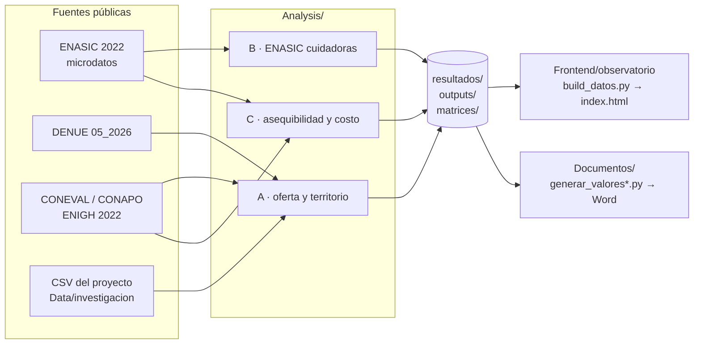

<div align="center">

# Observatorio de Datos para la Economía del Cuidado

**Proyecto integrador · 7.º semestre · Licenciatura en Ciencia de Datos para el Negocio**
Universidad Nacional Rosario Castellanos · semestre 2026-2


</div>

> **Antes de citar cualquier cifra de este repositorio:** las estimaciones de la ENASIC 2022 son **nacionales**. La encuesta no permite conclusiones por alcaldía ni estimaciones confiables para la Ciudad de México, y al ser su primera edición no hay tendencia. El componente territorial se construye con otras fuentes (DENUE, CONEVAL, CONAPO). El prototipo de `Frontend/` (fuera de `observatorio/`) usa **datos sintéticos** y no demuestra nada sobre la población real.

---

## Contenido

- [De qué trata](#de-qué-trata)
- [Estado al 8 de octubre de 2026](#estado-al-8-de-octubre-de-2026)
- [Tres hallazgos y sus límites](#tres-hallazgos-y-sus-límites)
- [Cómo fluyen los datos](#cómo-fluyen-los-datos)
- [Estructura del repositorio](#estructura-del-repositorio)
- [Cómo reproducir](#cómo-reproducir)
- [Qué no está en el repositorio y por qué](#qué-no-está-en-el-repositorio-y-por-qué)
- [Reglas de trabajo](#reglas-de-trabajo)
- [Equipo](#equipo)

---

## De qué trata

La institución asignó el tema (economía del cuidado); el equipo lo delimita. El producto final tiene dos partes:

1. **Un Observatorio de Datos** que reúne lo que las fuentes públicas sí permiten afirmar sobre quién cuida, a quién, con qué carga y con qué barreras para usar servicios.
2. **Un programa de innovación social** derivado de esos hallazgos. El 5 de octubre se eligió la **opción C**: la persona cuidadora familiar de alta intensidad como hallazgo de origen y la persona que recibe cuidado como beneficiaria, con un esquema de **relevo por horas**.

El trabajo se reparte entre seis unidades curriculares, cada una con su entregable:

| Unidad curricular | Entregable | Dónde vive aquí |
|---|---|---|
| Inteligencia de negocios | KPI y tablero | `Frontend/observatorio/`, `Analysis/matrices/diccionario_observatorio.csv` |
| Analítica para los negocios | Hallazgos y propuesta estratégica | `Analysis/` (notebooks A, B, C) |
| Herramientas y técnicas avanzadas | Modelo validado y documentado | Notebook B, sección 11 |
| Leyes para la protección de datos | Dictamen y protocolo de gobernanza | Pendiente |
| Seminario de titulación | Anteproyecto e informe | Word, fuera del repo; cifras desde `Documentos/generar_valores*.py` |
| Práctica profesional | Piloto en una institución real | Pendiente; los datos del piloto no entran a este repo |

## Estado al 8 de octubre de 2026

| Componente | Estado | Evidencia |
|---|---|---|
| Inventario y evaluación de fuentes | 27 fuentes y 2 documentos internos fichados | `Analysis/matrices/inventario_fuentes_cuidado.csv` |
| Análisis | 15 análisis consolidados en 3 notebooks (7 oct), ejecutados y sin errores | `Analysis/A_*.ipynb`, `B_*.ipynb`, `C_*.ipynb` |
| Modelo de focalización | Comparado contra la regla simple de 40 h; resultado mixto (ver abajo) | Notebook B, sección 11 |
| Observatorio en HTML | Prueba piloto navegable; todas sus cifras salen de `Analysis/` | `Frontend/observatorio/` |
| Doble revisión | **Pendiente** en la mayoría de los artefactos | `Documentos/bitacora-decisiones.md` |
| Componente territorial fino (AGEB/manzana contra demanda) | **No medible todavía**: falta el Censo 2020 por manzana | Notebook A, secciones 01 y 13 |
| Backend y ML de producción | Vacíos a propósito | `Backend/README.md`, `ML/README.md` |

Próxima fecha institucional: **2.ª revisión, del 2 al 6 de noviembre de 2026**.

## Tres hallazgos y sus límites

Cada cifra apunta al archivo que la produce. Ninguna se escribió a mano en este README.

**1. Casi nadie deja de buscar servicios de cuidado porque no los conozca.**
Entre las personas cuidadoras que no buscaron servicios, el 67.3 % (IC 90 %: 65.0–69.5) respondió «no ha tenido necesidad»; solo el 0.9 % (0.5–1.3) dijo desconocer que existen, y el 2.1 % (1.7–2.5) que son caros.
*Fuente:* `Analysis/resultados/03_enasic_barreras_estimaciones.csv`.
*Límite:* nacional. «No ha tenido necesidad» puede ocultar carga normalizada; la sección 07 lo explora, pero la encuesta no permite separarlo del todo. Un directorio de servicios no atendería la razón dominante.

**2. Por horas, el costo cabe en el ingreso de más hogares que la jornada completa.**
Al piso legal de 2026, un relevo de 6 h a la semana cuesta $1,112 al mes; en el 66.2 % de los hogares con necesidad de cuidado ese costo es igual o menor al 20 % de su ingreso. Con jornada completa (40 h) la proporción baja a 5.3 %.
*Fuente:* `Analysis/resultados/10_asequibilidad_relevo.csv` (n = 2,071 hogares en muestra).
*Límite:* nacional, proporción ponderada sin varianza de diseño. Que el costo quepa no significa que el hogar quiera o vaya a pagarlo.

**3. Un modelo ordena mejor que la regla de 40 h, pero no encuentra demostrablemente más casos.**
Para predecir «algún daño por cuidar», la regresión logística alcanza un AUC de 0.75 contra 0.63 de la regla; a la misma tasa de selección (40.7 %) cubre 2.2 puntos más, con IC 90 % de −4.1 a 8.5.
*Fuente:* `Analysis/resultados/11_modelo_focalizacion_global.csv`; por grupo en `11_modelo_focalizacion_por_grupo.csv`.
*Límite:* el modelo redistribuye la cobertura entre grupos (baja para quien cuida solo a una persona de 60+ sin discapacidad). Para «algún daño» basta la regla simple; el modelo sí la supera para «salud física deteriorada». La elección está abierta en la bitácora.

## Cómo fluyen los datos



La regla que sostiene el diagrama: **ningún número nace en la página ni en Word.** `build_datos.py` y `generar_valores*.py` leen los CSV de resultados y se detienen si falta un archivo o una fila esperada.

## Estructura del repositorio

```
pp26-2/
├── Analysis/
│   ├── A_oferta_y_territorio.ipynb          secciones 01, 02, 08, 09, 13
│   ├── B_enasic_cuidadoras.ipynb            secciones 03, 07, 12, 16, 11
│   ├── C_programa_asequibilidad_y_costo.ipynb  secciones 04, 05, 06, 10, 14
│   ├── resultados/   outputs/   figuras/    salidas de los notebooks (CSV y PNG)
│   ├── matrices/                            inventario de fuentes, tipologías, diccionario
│   ├── datos/                               insumos pequeños y públicos
│   ├── etoe/                                script ETOE 2020 (requiere microdatos)
│   ├── reproduccion_colmex_2026-09-22/      réplica del cuadro 2.2 de Colmex
│   └── oferta_demanda_v0_2026-09-14/        especificación previa, se conserva por historia
├── Data/                                    CSV de investigación y ficha del DENUE
├── Frontend/
│   ├── observatorio/                        Observatorio en HTML (datos reales agregados)
│   └── index.html, js/, css/                prototipo de app (datos sintéticos)
├── Documentos/
│   ├── bitacora-decisiones.md               registro de decisiones, append-only
│   ├── generar_valores*.py, _valores*.json  extracción de cifras para Word
│   └── build_*.js, comun.js                 generadores de los .docx (docx.js)
├── Backend/  ML/  Fotos/                    vacías a propósito; ver su README
├── scripts/                                 parches puntuales
├── ESTADO_SINCRONIZACION.md                 qué se recuperó, qué se reprodujo y qué falta
└── requirements.txt
```

La correspondencia entre las secciones de los notebooks y los antiguos notebooks sueltos está en [`Analysis/README.md`](Analysis/README.md). Una cifra citada como «notebook 04» se rastrea a la sección 04 del notebook C.

## Cómo reproducir

### 1. Entorno

```bash
git clone https://github.com/Zidnz/pp26-2.git
cd pp26-2
python -m venv .venv
# Windows: .venv\Scripts\activate    ·    Linux/macOS: source .venv/bin/activate
pip install -r requirements.txt
```

### 2. Datos que hay que descargar

| Archivo | Dónde va | Lo usa |
|---|---|---|
| Microdatos ENASIC 2022 en CSV (INEGI), descomprimidos | `Analysis/datos/enasic/` | Notebooks B y C |
| DENUE 05_2026, Ciudad de México (INEGI), como `denue_inegi_09_.csv` | `Data/raw/` | Notebook A, sección 01. Instrucciones en [`Data/README_notebook01.md`](Data/README_notebook01.md) |
| `grs_ageb_2020.csv.zip`, rezago social por AGEB (CONEVAL) | `Analysis/datos/coneval_irs/` | Notebook A, sección 13 |
| `pobreza22.csv.zip`, base de pobreza 2022 (CONEVAL con ENIGH 2022) | `Analysis/datos/enigh2022_coneval/` | Notebook C, sección 14 |
| Microdatos ETOE 2020, abril a junio, `cpv2020` en DBF (INEGI) | `Analysis/etoe/` | `etoe_cuidados.py` (ver su README) |

### 3. Orden de ejecución

```bash
cd Analysis
jupyter nbconvert --to notebook --execute --inplace A_oferta_y_territorio.ipynb
jupyter nbconvert --to notebook --execute --inplace B_enasic_cuidadoras.ipynb
jupyter nbconvert --to notebook --execute --inplace C_programa_asequibilidad_y_costo.ipynb
cd ..
python Frontend/observatorio/build_datos.py     # regenera los datos del Observatorio
```

Después, abrir `Frontend/observatorio/index.html` con doble clic: no necesita servidor ni conexión, salvo para las fuentes tipográficas.

Para regenerar los documentos Word (opcional): `npm install docx`, después uno de los `Documentos/generar_valores*.py` y el `build_*.js` correspondiente. **Esta secuencia no se ha vuelto a probar desde el 25 de septiembre**: `generar_valores_v3.py` escribe `_valores.json` en la carpeta desde la que se ejecuta y los `build_*.js` lo leen de `Documentos/`, así que hay que revisar la cabecera de cada script antes de correrlo.

### 4. Cómo saber si reprodujo bien

Los CSV de `Analysis/resultados/` están versionados. Si al ejecutar cambia alguno (`git diff --stat Analysis/resultados`), la diferencia se investiga y se registra en la bitácora antes de publicar cualquier cifra nueva.

## Qué no está en el repositorio y por qué

| Qué | Motivo |
|---|---|
| Microdatos ENASIC, ETOE y DENUE crudo | Tamaño (hasta 260 MB); se versiona el procedimiento para reconstruirlos |
| Cualquier dato personal, aun seudonimizado | Regla sin excepción del proyecto: se trabaja con población en situación de vulnerabilidad |
| Datos del piloto de práctica profesional | Permanecen en la institución receptora; el Observatorio solo usa agregados |
| Documentos Word y PDF | El informe cita los resultados, no los origina; se versionan sus generadores |
| Credenciales, claves y archivos `.env` | Bloqueados en `.gitignore` |

## Reglas de trabajo

- **Evidencia etiquetada.** Toda afirmación es *confirmada* (fuente y fecha), *probable* (con la base de la inferencia) o *desconocida*. «Desconocido» es una respuesta válida.
- **Afirmaciones acotadas.** Cada conjunto de datos permite ciertas afirmaciones y prohíbe otras; el inventario de fuentes lo registra en las columnas `permite_afirmar` y `prohibe_afirmar`.
- **Datos simulados declarados** en el repositorio, en el informe y en la presentación.
- **Modelo contra alternativa simple.** Que la regla simple iguale al modelo es un resultado publicable.
- **Historia real.** Cuando una decisión cambia se agrega una entrada con fecha y motivo en `Documentos/bitacora-decisiones.md`; no se reescriben las anteriores.
- **Doble revisión.** Quien produce un artefacto no es quien lo aprueba.

### Convención de commits

Commits pequeños con [Conventional Commits](https://www.conventionalcommits.org/es/v1.0.0/) en español:

```
feat(analysis): ...    nuevo análisis o resultado
feat(observatorio): ...  cambio en la página del Observatorio
fix(...): ...          corrección de un error
docs: ...              bitácora, README, fichas
refactor: ...          reorganización sin cambio de resultados
chore: ...             configuración del repositorio
```

Si un commit cambia una cifra publicada, el mensaje dice cuál y por qué.

## Equipo

| Integrante | Rol |
|---|---|
| Omar Gutiérrez Escoto | Líder del proyecto |
| Daniel Cureño Martínez | Integrante |
| Alondra Danae Madrigal García | Integrante |

**Licencia:** sin definir. Hasta que el equipo elija una, el código no está licenciado para reutilización. Los datos de terceros conservan los términos de su productor (por ejemplo, los Términos de Libre Uso de la Información del INEGI).
